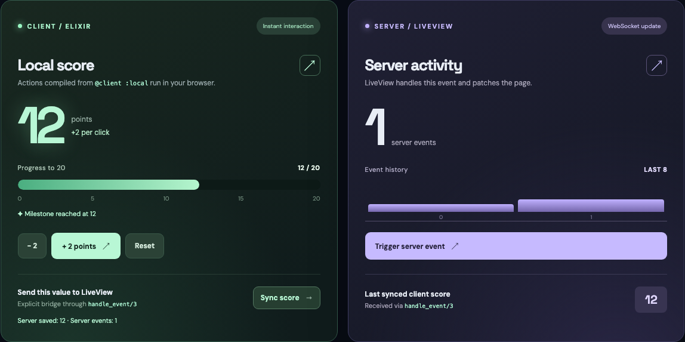

# LiveLift

**Elixir interactions in the browser, inside Phoenix LiveView.**

Keep your HEEx and `handle_event/3`. Add `use LiveLift` to a LiveView or
LiveComponent and mark the handlers you want to run in the browser.

[Try the demo](#try-the-demo) · [Add to a Phoenix app](#add-livelift-to-a-phoenix-app) · [How it works](docs/sync.md)



*The score changes in the browser. LiveView handles server activity and saves the score when you sync it.*

## One handler, three ways to run it

| Handler | What happens |
| --- | --- |
| `@client :local` | The browser updates the UI without sending a LiveView event after the hook mounts. Use it for previews, filters, or sorting. |
| `@client true` | The browser predicts the result immediately. LiveView runs the handler on the server and confirms or corrects the result. |
| Unmarked | LiveView handles the event on the server. Use this for persistence, permissions, or external calls. |

This counter uses ordinary HEEx and a local handler.

```elixir
defmodule MyAppWeb.Counter do
  use Phoenix.LiveComponent
  use LiveLift

  def render(assigns) do
    ~H"""
    <button type="button" phx-click="increment" phx-target={@myself}>
      Count: {@count}
    </button>
    """
  end

  @client :local
  def handle_event("increment", _params, socket) do
    {:noreply, update(socket, :count, &(&1 + 1))}
  end
end
```

Mount it from a LiveView with
`<.live_component module={MyAppWeb.Counter} id="counter" count={0} />`.
See the [native component guide](docs/native-livecomponent.md) for supported handlers.

## Try the demo

Run these commands from the repository root.

```sh
cd examples/demo
mix setup
mix phx.server
```

Open [the demo at localhost:4000](http://localhost:4000/) to try the score and
task list from the screenshot. Visit [`/local-actions`](http://localhost:4000/local-actions)
to compare all three event modes on one page.
See the [demo guide](https://github.com/Manuel1471/LiveLift/blob/main/examples/demo/README.md)
for more examples.

## Add LiveLift to a Phoenix app

| I want to… | Start here |
| --- | --- |
| Create a Phoenix app and see a working counter | [New project walkthrough](docs/phoenix-integration.md#start-a-new-phoenix-app) |
| Try LiveLift in an app I already have | [Opt in one handler](docs/phoenix-integration.md#adopt-livelift-in-an-existing-phoenix-app) |
| Keep my own JavaScript build or LiveSocket hooks | [Manual asset integration](docs/phoenix-integration.md#manual-asset-integration) |
| Check whether my Elixir and HEEx are supported | [Language reference](docs/language.md) |

LiveLift is experimental and supports Phoenix LiveView 1.2.x. Install the
[Hex package](https://hex.pm/packages/live_lift), which includes the
browser runtime. The [installation guide](docs/phoenix-integration.md#add-the-dependency)
also covers working from a local build.
See the [release instructions](https://github.com/Manuel1471/LiveLift/blob/main/docs/release.md)
for publication and public verification.

### Compatibility

| Environment | Published requirement or verification target |
| --- | --- |
| Elixir and OTP | The package declares Elixir `~> 1.15`. CI runs Elixir 1.18 with OTP 27 and Elixir 1.20 with OTP 29. |
| Phoenix | The installer and consumer checks use the Phoenix 1.8 layout and the 1.8.16 generator. |
| Phoenix LiveView | The package declares `~> 1.2.0`. The compatibility workflow tests 1.2.0 and 1.2.15. A weekly advisory runs against `main`. |
| Browsers | CI uses Playwright Chromium, Firefox and WebKit. See the [browser requirements](docs/production-readiness.md#browser-requirements) for the APIs required by the client runtime. |

## Go deeper

- [Event flow and state ownership](docs/sync.md) traces a prediction through server confirmation.
- [Adoption practices](docs/best-practices.md) covers state boundaries, parity tests, and measuring user feedback.
- [Development inspector](docs/state-inspector.md) shows browser snapshots. [Versioned assets](docs/versioned-assets.md) covers the runtime shipped in Hex and TypeScript.
- [Production limits](docs/production-readiness.md) and the [security model](docs/security.md) explain the tested boundaries.

## Development

```sh
mix deps.get
npm ci --prefix bench
mix test
npm test --prefix assets
```
